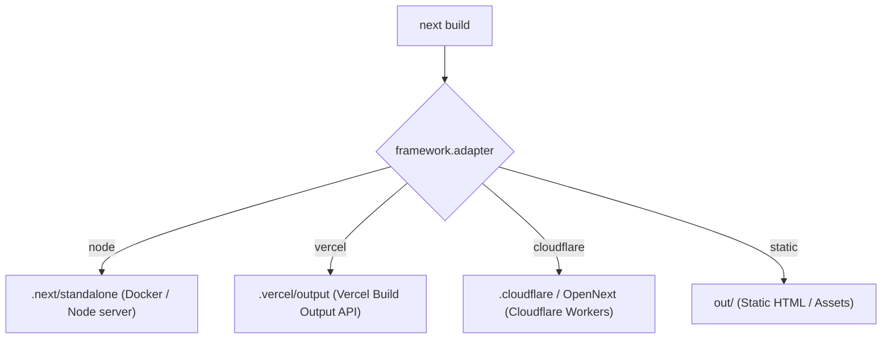

# Next.js Deployment Adapters Guide (M3)

> **Milestone:** M3 (`v2.0.0-beta`)  
> **Status:** Draft / Active (Wave 1)  
> **Related Issues:** `#8` (Next.js Epic), `#22` (Adapter Configuration), `#49` (Next.js Documentation)  
> **Applicable Versions:** `create-lumen` >= 2.0.0, Next.js >= 16.0.0  

---

## Table of Contents

1. [Architectural Overview & Purpose](#1-architectural-overview--purpose)
2. [Adapters Matrix](#2-adapters-matrix)
3. [Adapter Deep Dives](#3-adapter-deep-dives)
   - [Node Adapter (`node`)](#node-adapter-node)
   - [Vercel Adapter (`vercel`)](#vercel-adapter-vercel)
   - [Cloudflare Adapter (`cloudflare`)](#cloudflare-adapter-cloudflare)
   - [Static Export Adapter (`static`)](#static-export-adapter-static)
4. [Image Optimization per Adapter](#4-image-optimization-per-adapter)
5. [Bundler & Biome Tooling Notes](#5-bundler--biome-tooling-notes)
6. [Manifest v2 Configuration](#6-manifest-v2-configuration)

---

## 1. Architectural Overview & Purpose

In `create-lumen` v2, the `framework.adapter` option tailors the generated Next.js application to its intended deployment runtime.

Different infrastructure targets impose different constraints on runtime environments (Node.js vs. V8 isolates/workerd), build output artifacts, and asset delivery. Rather than requiring developers to manually configure `next.config.ts`, Dockerfiles, or edge runtime headers, `create-lumen` provides four first-class adapter targets:

- **`node`:** Self-hosted containerized environments (Docker, Kubernetes, AWS ECS, GCP Cloud Run).
- **`vercel`:** Native zero-config platform deployment on Vercel with edge caching and serverless functions.
- **`cloudflare`:** Global low-latency edge deployment on Cloudflare Pages/Workers (`workerd` runtime).
- **`static`:** Pure HTML/CSS/JS export for static storage (AWS S3 + CloudFront, GitHub Pages, Netlify Static).



---

## 2. Adapters Matrix

The following matrix contrasts the capabilities, output artifacts, and runtime characteristics of each adapter:

| Feature / Dimension | `node` | `vercel` | `cloudflare` | `static` |
| :--- | :--- | :--- | :--- | :--- |
| **Execution Runtime** | Node.js LTS (>= 20.x) | Node.js & Edge Serverless | Cloudflare `workerd` (Edge) | Browser / Static CDN |
| **`next.config` Output** | `output: "standalone"` | Default (automatic) | Automatic / Custom plugin | `output: "export"` |
| **Server-Side Rendering (SSR)** | Full | Full | Full (Node compatibility) | None |
| **Route Handlers / API** | Full Node APIs | Full Serverless / Edge | Edge compatible APIs | Static route generation only |
| **Image Optimization** | Built-in (Sharp) | Vercel Image Optimization | Cloudflare Images / Custom | Unoptimized / External CDN |
| **Streaming / RSC** | Native | Native | Native | Pre-rendered markup |
| **Build Artifact** | `.next/standalone` | `.vercel/output` | `.worker-next` / `.cloudflare` | `out/` |
| **Deployment Target** | Docker, K8s, VM | Vercel Platform | Cloudflare Pages / Workers | S3, GitHub Pages, Nginx |

---

## 3. Adapter Deep Dives

### Node Adapter (`node`)

The `node` adapter produces a self-contained bundle with minimal footprint, ideal for containerization.

#### `next.config.ts` Configuration
```ts
import type { NextConfig } from "next";

const nextConfig: NextConfig = {
  output: "standalone",
};

export default nextConfig;
```

#### Production Dockerfile Pattern
```dockerfile
FROM node:20-alpine AS runner
WORKDIR /app

ENV NODE_ENV=production
ENV PORT=3000
ENV HOSTNAME="0.0.0.0"

# Copy standalone server and static assets
COPY .next/standalone ./
COPY .next/static ./.next/static
COPY public ./public

EXPOSE 3000
CMD ["node", "server.js"]
```

---

### Vercel Adapter (`vercel`)

The `vercel` adapter relies on native platform conventions and provides optimal performance with zero custom configuration.

#### Key Features:
- Automatic detection of Route Handlers and Server Components.
- Automatic routing to the closest regional serverless compute regions.
- Out-of-the-box incremental static regeneration (ISR).

#### CLI Deployment:
```bash
npx vercel deploy
```

---

### Cloudflare Adapter (`cloudflare`)

The `cloudflare` adapter configures Next.js for Cloudflare Pages and Workers.

#### Runtime Considerations:
- Cloudflare uses the `workerd` V8 isolate runtime rather than a full Node.js binary.
- Node.js native bindings (C++ addons) are unsupported.
- Node standard libraries (`crypto`, `buffer`, `path`) require enabling the `nodejs_compat` flag in `wrangler.jsonc`.

#### `wrangler.jsonc` Configuration:
```jsonc
{
  "name": "my-lumen-app",
  "compatibility_date": "2026-09-23",
  "compatibility_flags": ["nodejs_compat"],
  "pages_build_output_dir": ".vercel/output/static"
}
```

---

### Static Export Adapter (`static`)

The `static` adapter configures Next.js to produce a pure static website containing HTML, CSS, JavaScript, and static media files in the `out/` folder.

#### `next.config.ts` Configuration:
```ts
import type { NextConfig } from "next";

const nextConfig: NextConfig = {
  output: "export",
  images: {
    unoptimized: true,
  },
};

export default nextConfig;
```

#### Constraints with Static Export:
- **No Dynamic SSR:** `getServerSideProps` or Server Components reading incoming request headers/cookies are prohibited.
- **Route Handlers:** Can only be used if they export static data that can be evaluated during `next build`.
- **Image Optimization:** Must set `images.unoptimized = true` or provide a custom loader (e.g. Cloudinary or Imgix).

---

## 4. Image Optimization per Adapter

| Adapter | Image Optimization Strategy | Configuration Requirement |
| :--- | :--- | :--- |
| `node` | Built-in Next.js Sharp engine | Install `sharp` in production dependencies for high performance. |
| `vercel` | Vercel Managed Image Optimization | Zero configuration. Handled by edge infrastructure. |
| `cloudflare` | Cloudflare Images / unoptimized | Use Cloudflare Image Resizing or `unoptimized: true`. |
| `static` | Disabled by default | Requires `images: { unoptimized: true }` in `next.config`. |

---

## 5. Bundler & Biome Tooling Notes

### Turbopack Compatibility Across Adapters
- **Local Dev:** `next dev --turbo` is supported across all adapter selections.
- **Production Build:** Builds are executed with `next build`. Turbopack build features are automatically aligned with the target adapter.

### Biome Integration
When `tooling.linter: "biome"` is selected:
- A root `biome.json` is generated.
- Biome enforces strict formatting, import sorting, and linting across all Next.js route files, layouts, and adapter configurations.
- Run `npx @biomejs/biome check --write .` prior to building.

---

## 6. Manifest v2 Configuration

An example `lumen.config.json` with the `node` adapter configured:

```json
{
  "$schema": "https://lumen-sh.github.io/create-lumen/schema/lumen.config.v2.json",
  "manifestVersion": 2,
  "framework": {
    "name": "next",
    "variant": "app-router",
    "bundler": "turbopack",
    "adapter": "node"
  },
  "styling": {
    "engine": "tailwind"
  },
  "architecture": {
    "preset": "feature-based",
    "type": "feature-based",
    "validation": "strict"
  },
  "ui": {
    "kit": "shadcn"
  },
  "docs": {
    "language": "en"
  },
  "paths": {
    "features": "src/features",
    "components": "src/shared/components",
    "services": "src/shared/services",
    "hooks": "src/shared/hooks",
    "pages": "src/app",
    "ui": "src/shared/components/ui"
  },
  "tooling": {
    "language": "ts",
    "linter": "eslint",
    "formatter": "prettier"
  }
}
```

---

## References

- [Next.js App Router Guide](./next-app-router.md)
- [Next.js Pages Router Guide](./next-pages-router.md)
- [Generator Engine & Capabilities](./engine-capabilities.md)
- [Manifest v2 Specification](./manifest-v2.md)
