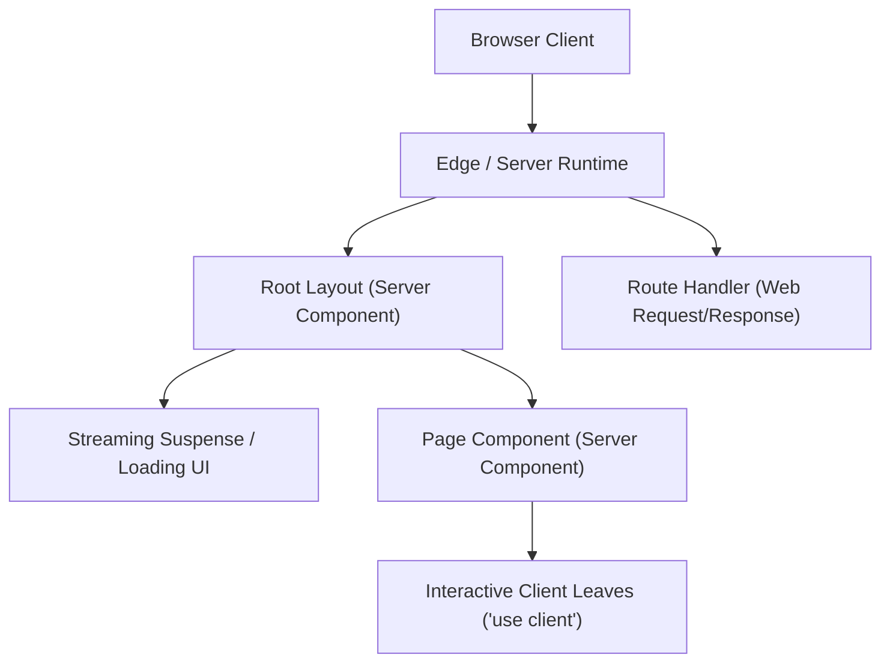

# Next.js App Router Architecture & Guide (M3)

> **Milestone:** M3 (`v2.0.0-beta`)  
> **Status:** Draft / Active (Wave 1)  
> **Related Issues:** `#8` (Next.js Epic), `#18` (App Router Base), `#20` (Filesystem Routing & Route Handlers), `#21` (Server/Client Boundaries & Font/Image), `#22` (Adapters), `#49` (Next.js Documentation)  
> **Applicable Versions:** `create-lumen` >= 2.0.0, Next.js >= 16.0.0, React >= 19.0.0  

---

## Table of Contents

1. [Architectural Overview & Philosophy](#1-architectural-overview--philosophy)
2. [App Router vs. Pages Router](#2-app-router-vs-pages-router)
3. [Filesystem Routing Architecture](#3-filesystem-routing-architecture)
   - [Directory Structure](#directory-structure)
   - [Root Layout (`layout.tsx`)](#root-layout-layouttsx)
   - [Page Entry (`page.tsx`)](#page-entry-pagetsx)
   - [Dynamic Routes (`blog/[slug]/page.tsx`)](#dynamic-routes-blogslugpagetsx)
   - [Special File Conventions (`loading.tsx`, `not-found.tsx`, `error.tsx`)](#special-file-conventions-loadingtsx-not-foundtsx-errortsx)
4. [Route Handlers](#4-route-handlers)
   - [Contract & Hello Endpoint (`api/hello/route.ts`)](#contract--hello-endpoint-apihelloroutets)
   - [HTTP Methods & Web Standard APIs](#http-methods--web-standard-apis)
5. [React Server Components (RSC) & Client Boundaries](#5-react-server-components-rsc--client-boundaries)
   - [Server Components by Default](#server-components-by-default)
   - [Client Boundary Directive (`"use client"`)](#client-boundary-directive-use-client)
   - [Boundary Rules & Best Practices](#boundary-rules--best-practices)
6. [Asset Optimization](#6-asset-optimization)
   - [Font Optimization (`next/font`)](#font-optimization-nextfont)
   - [Image Optimization (`next/image`)](#image-optimization-nextimage)
7. [Bundler, Compiler & Tooling](#7-bundler-compiler--tooling)
   - [Turbopack vs. Webpack](#turbopack-vs-webpack)
   - [React Compiler Integration](#react-compiler-integration)
   - [Linter & Formatter Parity (ESLint vs. Biome)](#linter--formatter-parity-eslint-vs-biome)
8. [Architecture Presets & Path Mappings](#8-architecture-presets--path-mappings)
9. [Manifest v2 Configuration](#9-manifest-v2-configuration)

---

## 1. Architectural Overview & Philosophy

In `create-lumen` v2, the **App Router** (`framework.name: "next"`, `framework.variant: "app-router"`) represents the recommended default architecture for production web applications built on Next.js 16 and React 19.

While `create-lumen` v1 was strictly bound to Vite and React Router with Single-Page Application (SPA) semantics, v2 introduces multi-framework capabilities managed via the `BaseProvider` seam (`NextAppRouterProvider`). Under the App Router:
- **Server-First Execution:** Components execute on the server by default (React Server Components), streaming HTML to the client without sending unnecessary JavaScript bundles.
- **Nested Routing & Layouts:** Routes share layouts that preserve state, maintain scroll position, and avoid expensive re-renders.
- **Web-Standard Primitives:** Endpoints and middleware use standard Web `Request` and `Response` interfaces instead of Node.js `IncomingMessage` and `ServerResponse`.
- **Integrated Tooling:** Built-in font optimization (`Geist`), responsive image rendering (`next/image`), and Turbopack bundling are pre-configured.



---

## 2. App Router vs. Pages Router

Choosing between the App Router and Pages Router determines how your components are rendered, how data is fetched, and how code is structured.

| Dimension | Next.js App Router (`app-router`) | Next.js Pages Router (`pages-router`) |
| :--- | :--- | :--- |
| **Component Model** | **React Server Components (RSC)** by default; opt-in client with `"use client"` | **Client Components** by default; executed on server during SSR/SSG |
| **Routing Directory** | `src/app/` (or `app/`) | `src/pages/` (or `pages/`) |
| **Layouts** | **Nested & Persistent** via `layout.tsx` hierarchy | Flat; manual composition or custom layout wrappers in `_app.tsx` |
| **Data Fetching** | Standard `async/await` in Server Components, `fetch()` cache options | `getServerSideProps`, `getStaticProps`, `getInitialProps` |
| **API Endpoints** | **Route Handlers** (`route.ts`) using standard `Request` / `Response` | **API Routes** (`pages/api/*.ts`) using `NextApiRequest` / `NextApiResponse` |
| **Loading & Errors** | Declarative file conventions (`loading.tsx`, `error.tsx`, `not-found.tsx`) | Manual state management or custom error pages (`404.tsx`, `500.tsx`) |
| **Streaming** | Native streaming with React `Suspense` and out-of-band updates | Limited; whole-page rendering or client-side fallback |
| **React Version** | React 19 native | React 19 compatible |
| **React Compiler** | Fully supported (`reactCompiler: true`) | Experimental / Partial |

---

## 3. Filesystem Routing Architecture

### Directory Structure

A project generated with `create-lumen` using `next:app-router` and TypeScript features the following directory tree:

```
my-next-app/
├── src/
│   ├── app/
│   │   ├── api/
│   │   │   └── hello/
│   │   │       └── route.ts          # Route Handler (GET -> 200 {hello:'lumen'})
│   │   ├── blog/
│   │   │   └── [slug]/
│   │   │       └── page.tsx          # Dynamic route param rendering
│   │   ├── favicon.ico
│   │   ├── globals.css               # Global Tailwind CSS v4 styles
│   │   ├── layout.tsx                # Root layout with fonts & metadata
│   │   ├── loading.tsx               # Instant Suspense loading state
│   │   ├── not-found.tsx             # 404 UI boundary
│   │   ├── page.module.css
│   │   └── page.tsx                  # Home route (/)
│   ├── shared/                       # Shared components and utilities
│   └── features/                     # Domain modules (when feature-based)
├── next.config.ts                    # Next.js configuration
├── package.json                      # Next ^16.0.0, React ^19.0.0
├── tsconfig.json                     # Paths (@/* -> ./src/*)
└── lumen.config.json                 # Manifest v2 configuration
```

### Root Layout (`layout.tsx`)

The root layout is required for all App Router applications. It wraps all pages and defines the root `<html>` and `<body>` tags:

```tsx
import type { Metadata } from "next";
import { Geist, Geist_Mono } from "next/font/google";
import "./globals.css";

const geistSans = Geist({
  variable: "--font-geist-sans",
  subsets: ["latin"],
});

const geistMono = Geist_Mono({
  variable: "--font-geist-mono",
  subsets: ["latin"],
});

export const metadata: Metadata = {
  title: "Lumen App",
  description: "Scaffolded with create-lumen",
};

export default function RootLayout({
  children,
}: {
  children: React.ReactNode;
}) {
  return (
    <html lang="en" className={`${geistSans.variable} ${geistMono.variable}`}>
      <body className="antialiased">{children}</body>
    </html>
  );
}
```

### Page Entry (`page.tsx`)

Pages are Server Components by default. They can directly fetch data using standard asynchronous operations:

```tsx
import Link from "next/link";

export default async function HomePage() {
  return (
    <main className="container mx-auto px-4 py-8">
      <h1 className="text-3xl font-bold tracking-tight">Welcome to Lumen Next.js</h1>
      <p className="mt-2 text-muted-foreground">
        Built with Next.js 16 App Router, React 19, and Tailwind CSS v4.
      </p>
      <div className="mt-4 flex gap-4">
        <Link href="/blog/welcome-to-lumen" className="underline hover:text-primary">
          View sample dynamic route
        </Link>
        <Link href="/api/hello" className="underline hover:text-primary">
          Check API route handler
        </Link>
      </div>
    </main>
  );
}
```

### Dynamic Routes (`blog/[slug]/page.tsx`)

Dynamic route parameters in Next.js 16 and React 19 are asynchronously resolved via `params`:

```tsx
interface PageProps {
  params: Promise<{
    slug: string;
  }>;
}

export default async function BlogPostPage({ params }: PageProps) {
  const { slug } = await params;

  return (
    <article className="container mx-auto px-4 py-8">
      <h1 className="text-2xl font-bold">Blog: {slug}</h1>
      <p className="mt-2">Rendering dynamic route segment for slug: <code>{slug}</code></p>
    </article>
  );
}
```

### Special File Conventions (`loading.tsx`, `not-found.tsx`, `error.tsx`)

- **`loading.tsx`:** Automatically creates a React `Suspense` boundary wrapping the adjacent `page.tsx` and nested children. Displays instantaneously on client-side navigation.
- **`not-found.tsx`:** Rendered when `notFound()` is invoked within a route segment, or when a requested URL matches no route.
- **`error.tsx`:** Client boundary (`"use client"`) that catches runtime errors occurring within the route subtree and renders a recovery fallback UI.

---

## 4. Route Handlers

Route Handlers are defined in `route.ts` (or `route.js`) files within the `app` directory. They replace the legacy `pages/api` endpoints and operate using Web standard `Request` and `Response` interfaces.

### Contract & Hello Endpoint (`api/hello/route.ts`)

Every `create-lumen` Next.js App Router scaffold adheres to the **M3 Parity Contract**:
A `GET` request to `/api/hello` returns HTTP status `200` with JSON body `{ hello: "lumen" }`.

```ts
import { NextResponse } from "next/server";

export async function GET() {
  return NextResponse.json({ hello: "lumen" });
}
```

### HTTP Methods & Web Standard APIs

Route Handlers support all standard HTTP verbs via named export functions:

```ts
import { NextRequest, NextResponse } from "next/server";

export async function GET(request: NextRequest) {
  const searchParams = request.nextUrl.searchParams;
  const query = searchParams.get("query") || "none";
  return NextResponse.json({ query });
}

export async function POST(request: NextRequest) {
  const body = await request.json();
  return NextResponse.json({ received: body }, { status: 201 });
}
```

---

## 5. React Server Components (RSC) & Client Boundaries

### Server Components by Default

In the App Router, every component is executed exclusively on the server unless explicitly annotated with `"use client"`. Server Components:
- **Zero Client Bundle:** Dependencies imported solely in Server Components are stripped from the browser bundle.
- **Direct Backend Access:** Can query databases, read the filesystem, and consume server-only secrets safely.
- **Streaming & Suspense:** Stream rendered markup to the browser as it becomes ready.

### Client Boundary Directive (`"use client"`)

To introduce interactivity (e.g., `useState`, `useEffect`, event listeners, browser APIs), define an explicit client boundary at the top of the file:

```tsx
"use client";

import { useState } from "react";

export function Counter() {
  const [count, setCount] = useState(0);

  return (
    <button
      onClick={() => setCount((c) => c + 1)}
      className="rounded bg-primary px-3 py-1 text-white"
    >
      Clicks: {count}
    </button>
  );
}
```

### Boundary Rules & Best Practices

1. **Push Boundaries to the Leaves:** Keep high-level page orchestrators and layout shells as Server Components. Extract interactive controls (buttons, modals, search bars) into isolated client components.
2. **Passing Server Components as Children:** A Client Component can accept Server Components via `children` without forcing the child to become a Client Component:
   ```tsx
   "use client";
   export function ClientWrapper({ children }: { children: React.ReactNode }) {
     return <div className="border p-4">{children}</div>;
   }
   ```
3. **No Server Secrets in Client Code:** Never import sensitive environment variables or server modules into files marked `"use client"`.

---

## 6. Asset Optimization

### Font Optimization (`next/font`)

`create-lumen` configures `@next/font` (specifically `Geist` and `Geist Mono` from `next/font/google`) out-of-the-box:
- **Zero Layout Shift:** Font metrics are matched during the build, eliminating Cumulative Layout Shift (CLS).
- **Self-Hosted at Build:** Google Fonts are downloaded at build time and served from the same domain; no external DNS or third-party requests are made at runtime.
- **CSS Variables:** Injected into `<html>` as `--font-geist-sans` and `--font-geist-mono`, referenced natively by Tailwind CSS v4.

### Image Optimization (`next/image`)

Use the Next.js `<Image />` component for automatic responsive resizing, modern format delivery (WebP/AVIF), and visual stability:

```tsx
import Image from "next/image";

export function Logo() {
  return (
    <Image
      src="/next.svg"
      alt="Next.js Logo"
      width={120}
      height={30}
      priority
    />
  );
}
```

> [!NOTE]
> When using the `static` deployment adapter, image optimization requires `unoptimized: true` in `next.config.ts`, or an external loader. See [`docs/next-adapters.md`](./next-adapters.md).

---

## 7. Bundler, Compiler & Tooling

### Turbopack vs. Webpack

`create-lumen` v2 allows selecting the bundler via the `framework.bundler` manifest option:
- **`turbopack` (Default):** Built in Rust, offering up to 10x faster local Fast Refresh and build performance. Invoked with `next dev --turbo`.
- **`webpack`:** Fallback legacy bundler for legacy plugin compatibility.

### React Compiler Integration

Next.js 16 supports the React 19 Compiler for automatic memoization without manual `useMemo` and `useCallback`:
- Enabled via `"reactCompiler": true` in `lumen.config.json`.
- Configured in `next.config.ts`:
  ```ts
  const nextConfig: NextConfig = {
    experimental: {
      reactCompiler: true,
    },
  };
  ```

### Linter & Formatter Parity (ESLint vs. Biome)

The capability descriptor for `next:app-router` supports:
- **Linters:** `eslint`, `biome`, `none` (`oxlint` is restricted to Vite/React targets).
- **Formatters:** `prettier`, `none` (Biome provides built-in formatting when selected as linter).

---

## 8. Architecture Presets & Path Mappings

`create-lumen` v2 supports three architecture presets for Next.js App Router:

1. **`feature-based`:**
   ```
   src/
   ├── app/             # Route handlers and layout orchestrators
   ├── features/        # Business logic domains (e.g. auth, billing, dashboard)
   └── shared/          # Shared UI primitives, hooks, services
   ```
2. **`hybrid`:**
   Enables co-location of feature components alongside App Router route directories while maintaining a top-level `shared/` directory.
3. **`none`:**
   Flat standard Next.js directory layout with routes located directly in `src/app/` and components in `src/components/`.

---

## 9. Manifest v2 Configuration

A typical `lumen.config.json` generated for Next.js App Router:

```json
{
  "$schema": "https://lumen-sh.github.io/create-lumen/schema/lumen.config.v2.json",
  "manifestVersion": 2,
  "framework": {
    "name": "next",
    "variant": "app-router",
    "bundler": "turbopack",
    "adapter": "node"
  },
  "styling": {
    "engine": "tailwind"
  },
  "architecture": {
    "preset": "feature-based",
    "type": "feature-based",
    "validation": "strict"
  },
  "ui": {
    "kit": "shadcn"
  },
  "docs": {
    "language": "en"
  },
  "paths": {
    "features": "src/features",
    "components": "src/shared/components",
    "services": "src/shared/services",
    "hooks": "src/shared/hooks",
    "pages": "src/app",
    "ui": "src/shared/components/ui"
  },
  "tooling": {
    "language": "ts",
    "linter": "eslint",
    "formatter": "prettier"
  },
  "reactCompiler": true,
  "agentDocs": true
}
```

---

## References

- [Next.js Pages Router Guide](./next-pages-router.md)
- [Deployment Adapters Guide](./next-adapters.md)
- [Generator Engine & Capabilities](./engine-capabilities.md)
- [Manifest v2 Specification](./manifest-v2.md)
