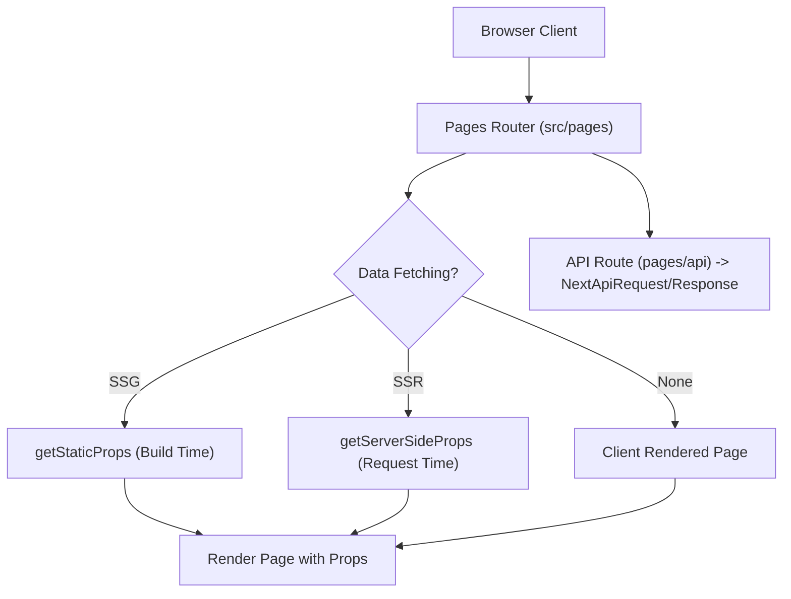

# Next.js Pages Router Architecture & Guide (M3)

> **Milestone:** M3 (`v2.0.0-beta`)  
> **Status:** Draft / Active (Wave 1)  
> **Related Issues:** `#8` (Next.js Epic), `#19` (Pages Router Variant), `#20` (Filesystem Routing & API Routes), `#21` (Font/Image Optimization), `#22` (Adapters), `#49` (Next.js Documentation)  
> **Applicable Versions:** `create-lumen` >= 2.0.0, Next.js >= 16.0.0, React >= 19.0.0  

---

## Table of Contents

1. [Architectural Overview & Philosophy](#1-architectural-overview--philosophy)
2. [Pages Router vs. App Router](#2-pages-router-vs-app-router)
3. [Filesystem Routing Architecture](#3-filesystem-routing-architecture)
   - [Directory Structure](#directory-structure)
   - [Custom App (`_app.tsx`)](#custom-app-_apptsx)
   - [Custom Document (`_document.tsx`)](#custom-document-_documenttsx)
   - [Home Page (`index.tsx`)](#home-page-indextsx)
   - [Dynamic Routes (`blog/[slug].tsx`)](#dynamic-routes-blogslugtsx)
   - [Custom Error Pages (`404.tsx`, `500.tsx`)](#custom-error-pages-404tsx-500tsx)
4. [API Routes (`pages/api`)](#4-api-routes-pagesapi)
   - [Contract & Hello Endpoint (`api/hello.ts`)](#contract--hello-endpoint-apihellots)
   - [Handler Signature & HTTP Methods](#handler-signature--http-methods)
5. [Data Fetching Lifecycle](#5-data-fetching-lifecycle)
   - [Static Site Generation (`getStaticProps` & `getStaticPaths`)](#static-site-generation-getstaticprops--getstaticpaths)
   - [Server-Side Rendering (`getServerSideProps`)](#server-side-rendering-getserversideprops)
   - [Client-Side Data Fetching](#client-side-data-fetching)
6. [Asset Optimization & Metadata](#6-asset-optimization--metadata)
   - [Font Optimization (`next/font`)](#font-optimization-nextfont)
   - [Image Optimization (`next/image`)](#image-optimization-nextimage)
   - [Document Head Management (`next/head`)](#document-head-management-nexthead)
7. [Bundler & Tooling Options](#7-bundler--tooling-options)
   - [Turbopack vs. Webpack](#turbopack-vs-webpack)
   - [Linter & Formatter Parity (ESLint vs. Biome)](#linter--formatter-parity-eslint-vs-biome)
8. [Architecture Presets & Path Mappings](#8-architecture-presets--path-mappings)
9. [Manifest v2 Configuration](#9-manifest-v2-configuration)

---

## 1. Architectural Overview & Philosophy

In `create-lumen` v2, the **Pages Router** (`framework.name: "next"`, `framework.variant: "pages-router"`) provides first-class support for the classic, battle-tested Next.js page-oriented paradigm.

Key architectural characteristics:
- **Page-Centric Mental Model:** Every file in `src/pages/` directly corresponds to an accessible web route.
- **Client-First Component Model:** Components are standard React client components. There are no React Server Component (RSC) boundaries, and the `"use client"` directive is neither needed nor recognized.
- **Explicit Data-Fetching Lifecycles:** Server-side execution is strictly contained within export functions (`getServerSideProps`, `getStaticProps`), while components render consistently on both server and client.
- **Node-Style API Handlers:** API routes in `src/pages/api/` consume Node-compatible request and response objects (`NextApiRequest`, `NextApiResponse`).



---

## 2. Pages Router vs. App Router

| Dimension | Next.js Pages Router (`pages-router`) | Next.js App Router (`app-router`) |
| :--- | :--- | :--- |
| **Component Model** | Standard Client Components (executed during SSR/SSG) | **React Server Components (RSC)** by default |
| **Root Directory** | `src/pages/` (or `pages/`) | `src/app/` (or `app/`) |
| **Layouts** | Flat; manually composed in `_app.tsx` or per-page `getLayout` | **Nested & Persistent** via `layout.tsx` |
| **Data Fetching** | `getStaticProps`, `getServerSideProps` | Native `async/await` in Server Components |
| **API Endpoints** | `pages/api/*.ts` (`NextApiRequest`, `NextApiResponse`) | `app/**/route.ts` (Web `Request` / `Response`) |
| **Head & Metadata** | `<Head>` component from `next/head` | Static/Dynamic `metadata` export in `layout.tsx` / `page.tsx` |
| **RSC Directives** | None (no `"use client"` or `"use server"`) | Required boundary markers (`"use client"`) |

---

## 3. Filesystem Routing Architecture

### Directory Structure

A project scaffolded with `next:pages-router` and TypeScript contains the following layout:

```
my-next-pages-app/
├── src/
│   ├── pages/
│   │   ├── _app.tsx                  # Custom App component & global styles
│   │   ├── _document.tsx             # Custom HTML/body document
│   │   ├── 404.tsx                   # Static Not Found page
│   │   ├── 500.tsx                   # Server Error page
│   │   ├── api/
│   │   │   └── hello.ts              # API Route (200 {hello:'lumen'})
│   │   ├── blog/
│   │   │   └── [slug].tsx            # Dynamic route param rendering
│   │   └── index.tsx                 # Root index route (/)
│   ├── styles/
│   │   ├── globals.css               # Global Tailwind CSS v4 styles
│   │   └── Home.module.css           # CSS module
│   ├── shared/                       # Shared components and utilities
│   └── features/                     # Feature domain modules
├── next.config.ts                    # Next.js configuration
├── package.json                      # Next ^16.0.0, React ^19.0.0
├── tsconfig.json                     # Paths (@/* -> ./src/*)
└── lumen.config.json                 # Manifest v2 configuration
```

### Custom App (`_app.tsx`)

`_app.tsx` initializes all pages. Use it to persist layouts between page changes, keep state when navigating pages, and inject global stylesheets:

```tsx
import type { AppProps } from "next/app";
import "@/styles/globals.css";

export default function App({ Component, pageProps }: AppProps) {
  return <Component {...pageProps} />;
}
```

### Custom Document (`_document.tsx`)

`_document.tsx` customizes the initial HTML document markup sent by the server. It executes exclusively on the server:

```tsx
import { Html, Head, Main, NextScript } from "next/document";

export default function Document() {
  return (
    <Html lang="en">
      <Head />
      <body className="antialiased">
        <Main />
        <NextScript />
      </body>
    </Html>
  );
}
```

### Home Page (`index.tsx`)

The index page serves `/` and utilizes `next/head` for title and meta attributes:

```tsx
import Head from "next/head";
import Link from "next/link";

export default function HomePage() {
  return (
    <>
      <Head>
        <title>Lumen Pages App</title>
        <meta name="description" content="Next.js Pages Router with create-lumen" />
      </Head>
      <main className="container mx-auto px-4 py-8">
        <h1 className="text-3xl font-bold">Welcome to Lumen Next.js (Pages Router)</h1>
        <p className="mt-2 text-muted-foreground">
          Built with Next.js 16 Pages Router, React 19, and Tailwind CSS v4.
        </p>
        <div className="mt-4 flex gap-4">
          <Link href="/blog/welcome-to-lumen" className="underline hover:text-primary">
            Dynamic Route Example
          </Link>
          <Link href="/api/hello" className="underline hover:text-primary">
            API Route Example
          </Link>
        </div>
      </main>
    </>
  );
}
```

### Dynamic Routes (`blog/[slug].tsx`)

Dynamic route parameters are matched via the brackets notation:

```tsx
import { useRouter } from "next/router";
import Head from "next/head";

export default function BlogPost() {
  const router = useRouter();
  const { slug } = router.query;

  return (
    <>
      <Head>
        <title>Blog: {slug}</title>
      </Head>
      <article className="container mx-auto px-4 py-8">
        <h1 className="text-2xl font-bold">Blog: {slug}</h1>
        <p className="mt-2">
          Rendering dynamic segment for slug: <code>{slug}</code>
        </p>
      </article>
    </>
  );
}
```

### Custom Error Pages (`404.tsx`, `500.tsx`)

- **`404.tsx`:** Static 404 page created at build time. Rendered whenever an unmapped URL is requested.
- **`500.tsx`:** Static or SSR 500 error page rendered when an unexpected server-side error occurs during data fetching.

---

## 4. API Routes (`pages/api`)

API routes provide backend endpoints directly inside the Next.js application without requiring an external server.

### Contract & Hello Endpoint (`api/hello.ts`)

Every `create-lumen` Next.js Pages Router scaffold adheres to the **M3 Parity Contract**:
A `GET` request to `/api/hello` returns HTTP status `200` with JSON body `{ hello: "lumen" }`.

```ts
import type { NextApiRequest, NextApiResponse } from "next";

type ResponseData = {
  hello: string;
};

export default function handler(
  req: NextApiRequest,
  res: NextApiResponse<ResponseData>
) {
  res.status(200).json({ hello: "lumen" });
}
```

### Handler Signature & HTTP Methods

Branch HTTP methods using `req.method`:

```ts
import type { NextApiRequest, NextApiResponse } from "next";

export default function handler(req: NextApiRequest, res: NextApiResponse) {
  if (req.method === "POST") {
    const data = req.body;
    return res.status(201).json({ received: data });
  }

  if (req.method === "GET") {
    return res.status(200).json({ status: "ok" });
  }

  res.setHeader("Allow", ["GET", "POST"]);
  return res.status(405).end(`Method ${req.method} Not Allowed`);
}
```

---

## 5. Data Fetching Lifecycle

### Static Site Generation (`getStaticProps` & `getStaticPaths`)

Pre-render HTML at build time for high performance and CDN caching:

```tsx
import type { GetStaticProps, GetStaticPaths } from "next";

export const getStaticPaths: GetStaticPaths = async () => {
  return {
    paths: [{ params: { slug: "first-post" } }],
    fallback: false,
  };
};

export const getStaticProps: GetStaticProps = async ({ params }) => {
  return {
    props: {
      slug: params?.slug,
      publishedAt: new Date().toISOString(),
    },
  };
};
```

### Server-Side Rendering (`getServerSideProps`)

Fetch data on every incoming request:

```tsx
import type { GetServerSideProps } from "next";

export const getServerSideProps: GetServerSideProps = async (context) => {
  return {
    props: {
      userAgent: context.req.headers["user-agent"] || "unknown",
    },
  };
};
```

### Client-Side Data Fetching

For frequently changing data or user-specific dashboards, perform client-side fetching inside components via standard `fetch`, TanStack Query, or SWR.

---

## 6. Asset Optimization & Metadata

### Font Optimization (`next/font`)

In Pages Router, `Geist` fonts are configured with `next/font/google`:

```tsx
import { Geist, Geist_Mono } from "next/font/google";

export const geistSans = Geist({
  variable: "--font-geist-sans",
  subsets: ["latin"],
});

export const geistMono = Geist_Mono({
  variable: "--font-geist-mono",
  subsets: ["latin"],
});
```

Inject the font variables into `_app.tsx` or page root container to make them available across Tailwind CSS v4 stylesheets.

### Image Optimization (`next/image`)

Use `<Image />` for intrinsic layout stability, automatic WebP/AVIF generation, and responsive srcsets:

```tsx
import Image from "next/image";

export function HeaderLogo() {
  return (
    <Image
      src="/next.svg"
      alt="Next.js"
      width={120}
      height={30}
      priority
    />
  );
}
```

### Document Head Management (`next/head`)

Manage page title, meta descriptions, and viewport attributes dynamically on a per-page basis using `<Head>`:

```tsx
import Head from "next/head";

export function SEO({ title, description }: { title: string; description: string }) {
  return (
    <Head>
      <title>{title}</title>
      <meta name="description" content={description} />
    </Head>
  );
}
```

---

## 7. Bundler & Tooling Options

### Turbopack vs. Webpack

- **`turbopack`:** Accelerated development bundler enabled by default in `create-lumen` v2. Invoked via `next dev --turbo`.
- **`webpack`:** Standard production and development bundler.

### Linter & Formatter Parity (ESLint vs. Biome)

The Pages Router variant supports:
- **Linters:** `eslint`, `biome`, `none` (`oxlint` is unsupported for Next.js).
- **Formatters:** `prettier`, `none` (Biome provides formatting when selected).

---

## 8. Architecture Presets & Path Mappings

`create-lumen` v2 supports three architecture presets for Next.js Pages Router:

1. **`feature-based`:**
   ```
   src/
   ├── pages/           # Thin page wrappers and API routes
   ├── features/        # Feature domains (components, hooks, models)
   └── shared/          # Reusable shared UI, utilities, and services
   ```
2. **`hybrid`:**
   Enables co-location of component files alongside routes while preserving feature directories.
3. **`none`:**
   Standard Next.js structure with `src/pages/` and `src/components/`.

---

## 9. Manifest v2 Configuration

A sample `lumen.config.json` generated for Next.js Pages Router:

```json
{
  "$schema": "https://lumen-sh.github.io/create-lumen/schema/lumen.config.v2.json",
  "manifestVersion": 2,
  "framework": {
    "name": "next",
    "variant": "pages-router",
    "bundler": "turbopack",
    "adapter": "node"
  },
  "styling": {
    "engine": "tailwind"
  },
  "architecture": {
    "preset": "feature-based",
    "type": "feature-based",
    "validation": "strict"
  },
  "ui": {
    "kit": "shadcn"
  },
  "docs": {
    "language": "en"
  },
  "paths": {
    "features": "src/features",
    "components": "src/shared/components",
    "services": "src/shared/services",
    "hooks": "src/shared/hooks",
    "pages": "src/pages",
    "ui": "src/shared/components/ui"
  },
  "tooling": {
    "language": "ts",
    "linter": "eslint",
    "formatter": "prettier"
  },
  "agentDocs": true
}
```

---

## References

- [Next.js App Router Guide](./next-app-router.md)
- [Deployment Adapters Guide](./next-adapters.md)
- [Generator Engine & Capabilities](./engine-capabilities.md)
- [Manifest v2 Specification](./manifest-v2.md)
